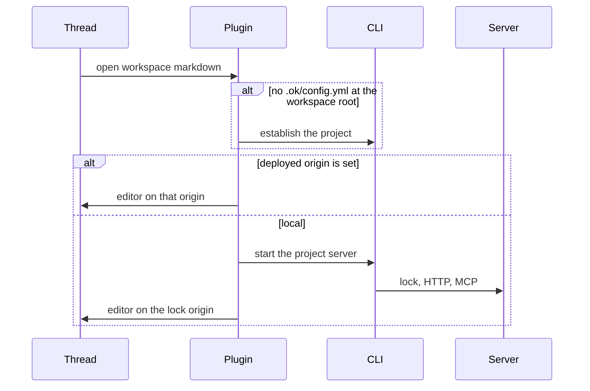

# feat: OpenKnowledge as the BB project editor

**Target repo:** open-knowledge-bb. Paths below are relative to that repo. BB host paths are marked `(bb)`.

## Summary

Opening a workspace markdown file uses this editor when Settings, File openers selects this plugin. Until then, Docs or BB's preview can still open it. The plugin establishes an OpenKnowledge project for that workspace when one does not exist. It runs that folder's own server and MCP server unless a deployed origin is set. The settings gear, the comment log, the sync status, and the BB look all live in that editor.

## Problem Frame

The editor panel loads one hardcoded dev entry. It does not follow the BB project, so two projects can share one server and write the same files. Comments stay in OpenKnowledge and never reach the thread. Settings and sync still belong to the OpenKnowledge dialog. The page uses its own palette, type scale, and Lucide icons, and the iframe cannot read BB's styles.

## Requirements

### Project and editor

- R1. A markdown file from a BB workspace opens in this editor on that workspace's OpenKnowledge server when Settings, File openers selects this plugin.
- R2. The first open of a workspace that is not an OpenKnowledge project runs the CLI to establish one, then starts that project's local server, unless a deployed origin is already set. The opened file does not have to be the first file in the folder.
- R3. Each workspace root has its own server and its own MCP endpoint. A second project does not reuse the first project's server.
- R4. A project setting selects a deployed server. When it is set, the editor uses that origin and does not start a local server for that project.
- R5. Host paths and thread-storage paths do not gain an OpenKnowledge project. They keep BB's existing preview.

### Settings, comments, and sync

- R6. The settings gear opens User, This project, Plugins, and Integrations inside the editor panel, plus the project server choice and sync configuration.
- R7. A comment is still stored in the OpenKnowledge comment log. A separate action adds the document path and the quoted text to the open BB thread composer.
- R8. The sync control stays visible and reports that project's sync. Sync configuration and the sync action are BB's. The OpenKnowledge sync engine does not also push or pull that folder.

### Appearance

- R9. On the BB editor host, color, type size, and UI monospace match BB. Chrome, controls, and document icons with a Hugeicons match use Hugeicons. A document icon name with no Hugeicons match still renders with Lucide. Code blocks keep JetBrains Mono. The upstream app is unchanged when the host flag is off.

## Key Technical Decisions

- KTD1. The workspace root BB passes is the OpenKnowledge project root. Init must not walk to an ancestor checkout or a different `content.dir`. An existing `.ok/config.yml` at that root is reused. Init runs only when that file is missing. A `content.dir` that does not contain the opened path is an error, not a retarget.
- KTD2. Init scaffolds `.ok/` at the workspace directory the plugin passes, including when an ancestor already has `.ok/` or a git root. It skips other editors' MCP config and skill install. It does not create a git repo when the workspace already has one. The project's MCP server stays the HTTP endpoint `ok start` already serves.
- KTD9. BB RPC stays the channel between the plugin page and the BB host. The knowledge server and its MCP endpoint stay OpenKnowledge's. This plan does not reimplement the CLI or MCP as BB RPC.
- KTD3. The iframe origin comes from that project's server lock, or from the deployed origin in project settings. The entry is `bb.html` on that origin. A workspace thread tab uses that origin. A thread with no workspace renders the empty explanation and does not load a shared dev entry.
- KTD4. The file opener is registered for the same markdown extensions the Docs plugin uses. BB chooses the winner from Settings, File openers. This plan does not remove the Docs plugin.
- KTD5. The gear keeps the in-editor settings dialog. On this host that dialog is the settings page, and the BB-owned server and sync fields are read through the plugin. The left-rail section stays a short pointer to that page.
- KTD6. The comment action posts the path and quote to the plugin page, which inserts them at the end of the thread composer and focuses it. Creating the OpenKnowledge comment is unchanged.
- KTD7. On this host the OpenKnowledge sync engine does not auto-sync. The status control reads BB's sync for the workspace. A folder with no remote still shows the control.
- KTD8. Icons go through one host-aware set. The BB host uses Hugeicons. A document icon name with no Hugeicons match still renders with Lucide. Colors and type are a host override of the editor's own tokens, using BB's canvas, ink, and system monospace. Code keeps JetBrains Mono.

## High-Level Technical Design

This illustrates the intended approach and is directional guidance for review, not implementation specification. The implementing agent should treat it as context, not code to reproduce.

## Scope Boundaries

- The remote-url plugin is unchanged.
- Agent, terminal, home-prompt, and header cuts already in the working tree stay as they are.
- A custom BB palette does not flow into the iframe. The match is the one written into this host.
- Citation line ranges are unchanged. The opener opens the document.
- Linked worktrees are separate folders and get separate servers.

### Deferred to Follow-Up Work

- Compiling the editor into the plugin bundle so it shares BB's document.
- Replacing the OpenKnowledge CLI or its MCP server with BB RPC.
- Registering the project MCP server inside the BB thread when the plugin SDK has no registration for it. U1 still records the endpoint.

## System-Wide Impact

- One OS process, one lock, and one MCP endpoint per workspace root that is running a local server. A deployed origin does not start that process. A second BB project must not attach to the first lock.
- Comment files stay under that project's content directory. The BB composer only receives a copy of the quote.
- Two sync engines on one folder will diverge. R8 is the guard.
- The plugin's SDK pin has to include the file opener and the composer API the Docs plugin already uses.

## Risks & Dependencies

- Init prompts when stdin is a terminal. The plugin invocation has to be the non-interactive path, or the file never opens.
- `ok start` can exit successfully when it reuses a lock, and can exit unsuccessfully while the lock is still being written. The plugin treats a readable lock as success.
- A loopback server shuts down after idle time. An opener that is still mounted restarts that project's server when the lock disappears.
- The production server currently serves the upstream entry at `/`. The BB entry has to be served on the project origin or the iframe shows the wrong app.
- The Docs plugin registers the same extensions. Until the user pins this opener, markdown can still open in Docs or in BB's preview.

## Acceptance Examples

- AE1. A new BB workspace has no `.ok/`. Opening `notes/a.md` establishes the project at the workspace root, starts its server, and shows that file. `notes/a.md` is not required to exist before init.
- AE2. Opening a markdown file in a second workspace uses a different origin than the first.
- AE3. A project whose setting names a deployed origin opens that origin and does not start a local server.
- AE4. Opening a thread-storage markdown file leaves it on BB's preview and does not create `.ok/`.
- AE5. Adding a comment stores it in the OpenKnowledge log and leaves the thread composer unchanged. Add to BB chat appends the path and quote to the composer and leaves the log entry in place.
- AE6. A workspace with no git remote still shows the sync control. The control does not run the OpenKnowledge push or pull.

## Implementation Units

### U1. Project server for a workspace

- **Goal:** Given a workspace root, ensure an OpenKnowledge project, start or reuse its server, and resolve the editor origin and MCP endpoint.
- **Requirements:** R2, R3, R4
- **Dependencies:** None
- **Files:** `bb-plugin/server.ts`, `bb-plugin/app.tsx`, `bb-plugin/app.test.tsx`, `packages/cli/src/commands/init.ts`, `packages/cli/src/commands/start.ts`, `packages/server/src/boot.ts`
- **Approach:** The plugin runs init only when `.ok/config.yml` is missing at the workspace root. Init accepts the workspace directory as the project root and does not walk to an ancestor. It uses the flags that skip other editors' MCP config and skill install. It then starts the server unless the project setting names a deployed origin. The origin is the deployed URL or the origin recorded in the server lock. The BB editor entry on that origin is what later units iframe. A readable lock counts as started. While an editor surface for that project is mounted, a missing lock starts the server again. The MCP URL is stored with the project. Init and start behavior stay in the CLI. The plugin does not reimplement project scaffolding.
- **Patterns to follow:** `packages/cli/src/commands/init.ts`, `packages/cli/src/commands/start.ts`, the lock path under `.ok/local/`
- **Test scenarios:**
  - A workspace with no `.ok/` ends with a project marker at that root and a resolved local origin. Covers AE1.
  - A workspace nested under an ancestor `.ok/` or an ancestor git root still gets `.ok/config.yml` at the workspace root and its own origin.
  - A workspace that already has `.ok/config.yml` is not initialized again, and its existing content root is left as it is.
  - Two workspace roots resolve two origins. Covers AE2.
  - A deployed origin setting resolves that origin and does not require a local lock. Covers AE3.
  - Init invoked the way the plugin invokes it does not open an interactive prompt and does not write another editor's MCP config.
  - A start that reuses a readable lock still returns the origin.
  - A dropped lock while the surface is mounted is started again.
- **Verification:** The plugin can answer, for a workspace root, the editor origin and the MCP URL. A second root does not receive the first origin.

### U2. Markdown file opener

- **Goal:** A workspace markdown file opens in the BB editor on the origin from U1, at that document.
- **Requirements:** R1, R5
- **Dependencies:** U1
- **Files:** `bb-plugin/app.tsx`, `bb-plugin/app.test.tsx`, `bb-plugin/package.json`, `packages/app/bb.html`, `packages/app/vite.entries.ts`
- **Approach:** Register a file opener for the markdown extensions. Workspace sources go through U1 and iframe the BB entry at the opened document. Host and thread-storage sources render BB's preview and do not call U1. The nav panel and the fixed thread tab use the active thread's workspace origin from U1. When that thread has no workspace, the panel says so. The production server must serve the BB entry. Raise the plugin SDK pin to one that includes the file opener and composer APIs.
- **Patterns to follow:** `(bb) plugins/docs/app.tsx` file opener, `bb-plugin/app.tsx` iframe surface
- **Test scenarios:**
  - A workspace path `notes/a.md` produces an iframe whose origin is that project's origin and whose target is that document. Covers AE1.
  - A thread-storage path renders the built-in preview and does not request a project server. Covers AE4.
  - A host path does the same as thread storage.
  - The thread tab for a workspace uses that workspace's origin, not the hardcoded dev URL.
  - The thread tab with no workspace renders the empty explanation.
- **Verification:** Opening a workspace markdown file shows the BB editor on that file. Opening a non-workspace markdown file shows BB's preview.

### U3. Settings inside the editor

- **Goal:** The gear opens the editor settings page, including the BB project fields.
- **Requirements:** R4, R6
- **Dependencies:** U1
- **Files:** `packages/app/src/components/SettingsButton.tsx`, `packages/app/src/components/settings/SettingsDialogShell.tsx`, `packages/app/src/components/settings/SettingsDialogBody.tsx`, `packages/app/src/lib/use-settings-route.ts`, `bb-plugin/server.ts`, `bb-plugin/app.tsx`, `packages/app/src/components/SettingsButton.dom.test.tsx`, `packages/app/src/components/settings/SettingsDialogShell.dom.test.tsx`
- **Approach:** On the BB host the gear opens the in-editor settings dialog and does not send the user to the left rail. The dialog keeps User, This project, Plugins, and Integrations. Server choice and sync configuration are sections in that dialog, backed by plugin project settings. The left-rail plugin section describes that page and does not duplicate the fields. Agents and terminal stay omitted on this host.
- **Patterns to follow:** `SettingsDialogShell.tsx` group list, `bb-plugin/server.ts` settings definition, `settings-host-gates.ts`
- **Test scenarios:**
  - On the BB host, activating the gear shows User, This project, Plugins, and Integrations.
  - The same activation shows the server choice and the sync configuration.
  - Changing the server choice to a deployed origin is what U1 reads. Covers AE3.
  - With the host flag off, the gear still opens the existing dialog and does not show the BB project fields.
  - The left-rail section does not contain the project field controls.
- **Verification:** From the editor, the user can change the deployed origin and see the sync configuration without leaving the panel.

### U4. Add a comment to the BB thread

- **Goal:** The comment log stays, and one action copies the quote into the thread composer.
- **Requirements:** R7
- **Dependencies:** U2
- **Files:** `packages/app/src/comments/`, `bb-plugin/app.tsx`, `bb-plugin/app.test.tsx`, `packages/app/src/comments/comment-send-footer.dom.test.tsx`
- **Approach:** Submitting a comment still writes the OpenKnowledge comment log. A second action on that comment sends the document path and the quoted text to the plugin page that hosts the iframe. That page inserts the text at the end of the open thread composer and focuses it. The page accepts the message only from the origin it iframed. The log entry remains after the insert.
- **Patterns to follow:** `(bb) plugins/docs/app.tsx` composer insert, `packages/app/src/comments/comments-client.ts`
- **Test scenarios:**
  - Submitting a comment creates the log entry and does not change the composer. Covers AE5.
  - The second action appends the path and the quote and leaves the log entry. Covers AE5.
  - A message from an origin other than the iframed project origin does not change the composer.
  - The action while no thread composer is mounted reports that and does not drop the log entry.
- **Verification:** A comment is visible in the OpenKnowledge comments list, and Add to BB chat shows that quote in the thread composer.

### U5. BB look on this host

- **Goal:** The BB editor host uses BB's color, type, and icons.
- **Requirements:** R9
- **Dependencies:** None
- **Files:** `packages/app/src/globals.css`, `packages/app/src/lib/bb-editor-host.ts`, `packages/app/src/editor/registry/icons.ts`, `packages/app/src/components/file-entry-icon.tsx`, `packages/app/package.json`, a new host icon module under `packages/app/src/`, `packages/app/src/editor/registry/icons` tests, `packages/app/src/components/file-entry-icon.test.tsx`
- **Approach:** A host override sets the editor's background, text, border, sidebar, and type size from BB's canvas, ink, and type scale, and sets the UI monospace to the system stack. Code and diff fonts stay JetBrains Mono. Chrome and control icons resolve through one module. On this host that module returns Hugeicons. Off this host it returns the current Lucide icons. A document icon name with no Hugeicons match still renders with Lucide. Add a changeset for the app behavior.
- **Patterns to follow:** `(bb) apps/app/src/components/ui/theme.css`, `(bb) plugins/docs/app.tsx` Hugeicons imports, `packages/app/src/editor/registry/icons.ts`
- **Test scenarios:**
  - With the host flag on, the background, text, type size, and UI monospace tokens are the BB values, and the code font is JetBrains Mono.
  - With the host flag off, those tokens stay the current editor values.
  - A header icon and a file-tree icon resolve to Hugeicons on the host and to Lucide off the host.
  - A document icon name that has a Hugeicons match resolves to it on the host.
  - A document icon name that has no Hugeicons match still resolves to a visible Lucide icon.
- **Verification:** The BB editor page shows the BB palette, BB type size, and Hugeicons. A document icon with no Hugeicons match still shows its Lucide icon. The upstream entry does not.

### U6. Sync status from BB

- **Goal:** The sync control reports BB sync and does not run a second engine.
- **Requirements:** R8
- **Dependencies:** U1, U3
- **Files:** `packages/app/src/components/SyncStatusBadge.tsx`, `packages/app/src/components/settings/SettingsDialogBody.tsx`, `packages/server/src/boot.ts`, `bb-plugin/server.ts`, `packages/app/src/components/AppHeader.dom.test.tsx`
- **Approach:** On this host the server does not start the OpenKnowledge auto-sync. The status control stays in the header, including when the folder has no remote. Its state comes from BB's sync for that workspace. Actions from the control and from the sync settings in U3 call BB. They do not call the OpenKnowledge pull, push, or manual sync.
- **Patterns to follow:** `SyncStatusBadge.tsx`, `(bb) plugins/git/app.tsx` thread actions
- **Test scenarios:**
  - On the BB host, with no remote, the sync control is still rendered and does not offer the OpenKnowledge push or pull. Covers AE6.
  - On the BB host, with a remote, the control shows BB's status and a sync action calls BB.
  - On the BB host, server boot does not start the OpenKnowledge auto-sync.
  - With the host flag off, the existing badge behavior remains.
- **Verification:** The header control is visible, its action is BB's, and the OpenKnowledge engine is not syncing that folder.

## Sources / Research

- Project marker and init: `packages/cli/src/commands/init.ts`, `packages/core/src/constants/ok-dir.ts`
- Server lock and start: `packages/cli/src/commands/start.ts`, `packages/server/src/process-lock.ts`
- Comment log: `packages/server/src/comments/thread-store.ts`, `packages/app/src/comments/comments-client.ts`
- Settings groups: `packages/app/src/components/settings/SettingsDialogShell.tsx`
- Host flag: `packages/app/src/lib/bb-editor-host.ts`, `packages/app/src/bb-main.tsx`
- File opener and composer insert: `(bb) plugins/docs/app.tsx`
- BB tokens: `(bb) apps/app/src/components/ui/theme.css`
